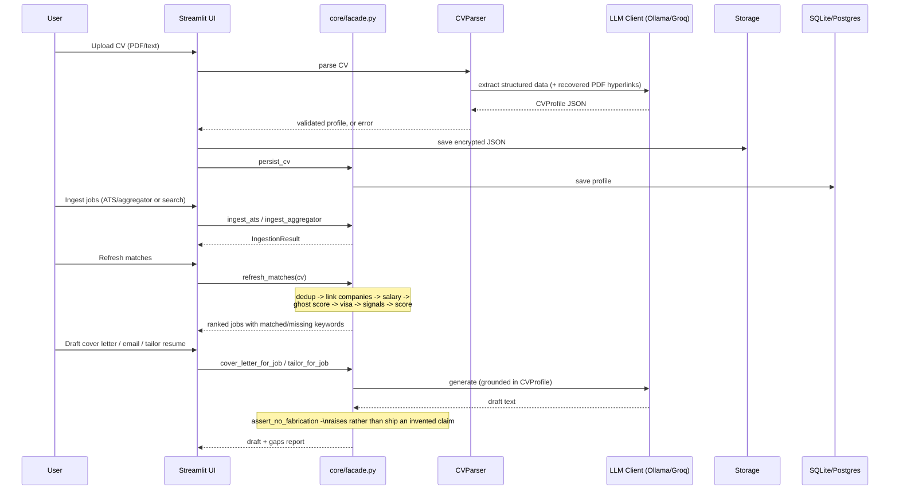

# CareerAgent Architecture

This document describes the software architecture of CareerAgent, a local
AI-powered career assistant for personalized job search and outreach.

## System overview

CareerAgent is a Streamlit UI over a `core/` package of independent business-
logic services — `app.py` holds no business logic itself. It reaches `core/`
two ways: the DB-backed platform services (ingestion, matching, resume,
tracking, outreach, analytics) go through `core/facade.py`; the original
CV/contact/personalization/storage modules are instantiated directly
by `app.py` (see the diagram below — the `UI --> CF/PE/DV/Gmail/WA` edges
are that direct path, not routed through the facade). A 2026-08 repo audit
flagged this as worth unifying behind the facade; not yet done. LLM
inference runs against Ollama locally by default,
with an OpenAI-compatible cloud provider (Groq's free tier) as an opt-in
alternative (see ADR 0005). Persistence is SQLModel on SQLite for dev
(Postgres in production, ADR 0003), with a legacy local-JSON path still used
for drafts/exports.

```mermaid
graph TB
    subgraph "Presentation Layer"
        UI[Streamlit UI<br/>app.py]
    end

    subgraph "Facade"
        Facade[core/facade.py]
    end

    subgraph "Core Services"
        CV[CV Parser]
        Resume[Resume: tailor, cover letter,<br/>ATS lint, render]
        Ingestion[Ingestion: ATS + aggregators]
        Fetching[Fetching: JSON-LD, polite crawler]
        Matching[Matching: embeddings, dedup, scoring]
        Tracking[Tracking: kanban pipeline]
        Outreach[Outreach: compliance gate]
        Enrichment[Enrichment: salary, visa, ghost score]
        Analytics[Analytics: funnel, interview prep]
        Alerting[Alerting: digest]
        CF[Contact Finder]
        PE[Personalization Engine]
        DV[Draft Validator]
    end

    subgraph "Integration Layer"
        LLM[LLM Client<br/>Ollama or Groq]
        Gmail[Gmail Drafts]
        WA[WhatsApp]
        DDG[DuckDuckGo Search]
    end

    subgraph "Data Layer"
        DB[(SQLite/Postgres<br/>core/db)]
        Storage[Local JSON Storage]
        Models[Pydantic Models]
    end

    subgraph "External Services"
        OllamaSvc[(Ollama, local)]
        GroqSvc[(Groq API, cloud)]
        GmailAPI[(Gmail API)]
        JobAPIs[(Greenhouse/Lever/Ashby/<br/>Adzuna/Muse/Remotive)]
    end

    UI --> Facade
    Facade --> Resume
    Facade --> Ingestion
    Facade --> Fetching
    Facade --> Matching
    Facade --> Tracking
    Facade --> Outreach
    Facade --> Enrichment
    Facade --> Analytics
    Facade --> Alerting
    UI --> CV
    UI --> CF
    UI --> PE
    UI --> DV
    Facade --> Gmail
    UI --> WA
    CV -.->|persist_cv| Facade

    CV --> LLM
    Resume --> LLM
    CF --> LLM
    CF --> DDG
    PE --> LLM
    Ingestion --> JobAPIs

    LLM --> OllamaSvc
    LLM --> GroqSvc
    Gmail --> GmailAPI

    Facade --> DB
    CV --> Storage
    PE --> Storage

    CV --> Models
    Resume --> Models
    Ingestion --> Models
    Matching --> Models
```

## Component map

### Presentation

| Component | File | Description |
|-----------|------|-------------|
| Streamlit UI | `app.py` | 6 screens. DB-backed operations and compliant Gmail creation use `core/facade.py`; CV parsing, contact finding, personalization, and legacy storage still have direct calls. |

### Facade

| Component | File | Description |
|-----------|------|-------------|
| Facade | `core/facade.py` | Session-managed gateway for DB-backed features and compliant Gmail creation; returns domain objects or plain values, never detached ORM rows. |

The facade lists recent saved-profile metadata and loads encrypted profiles on
explicit selection. Profile changes trigger a local match refresh. Selected and
pasted jobs are upserted into the same job repository as API records; persisted
postings can open Draft Studio directly. Source/attribution fields survive card
serialization. The UI keeps generated material and editor state in per-job
session workspaces, invalidating them when the active profile changes (ADR 0007).

#### Candidate answers and apply flow (ADR 0009)

These return plain dicts or Pydantic models and are not wired into `app.py`
yet.

| Function | Returns |
|---|---|
| `save_candidate_profile(cv_id, candidate: CandidateProfile \| dict)` | `{"ok": True, "cv_id"}` or `{"ok": False, "error"}`. Validates a form dict before storing it encrypted. |
| `load_candidate_profile(cv_id)` | `CandidateProfile` (all-unknown if nothing saved yet) or `None` if the CV doesn't exist. |
| `profile_completeness(cv, candidate=None)` | `{"percent", "items", "missing", "next_best_action"}`; items are `{"key", "label", "done", "weight", "why", "section"}`, with missing items ordered most valuable first. |
| `extension_profile(cv, candidate=None, include_resume=False)` | The popup's import JSON: seven string identity keys; with a candidate, `location`, website fallback for `portfolio`, and `answers`; optionally a `resume` block (`filename`, `mime`, `data_b64`). |
| `apply_target(job_id)` | `{"ok", "job_id", "title", "company", "url", "ats", "autofill_supported", "note"}`; `url` is only an http(s) link. |
| `mark_applied(job_id, cv_profile_id=None)` | `{"ok", "application_id", "status", "changed"}`; tracks the job if needed and moves SAVED to APPLIED once. |

`top_jobs` cards also carry `salary_currency` and ISO `date_posted` for the
pure card helpers in `core/presentation.py`.

An AI connection is required for parsing and prose generation. Browsing,
tracking, deterministic resume tailoring, profile review, and exports work
without one. PR Docker checks execute actual screens and encrypted persistence
across replacement containers in addition to probing server health.

### Core services

| Package/module | Description |
|---|---|
| `core/candidate.py` | `CandidateProfile`: answers to form questions a CV can't (work authorization, sponsorship, compensation, availability, preferences, opt-in demographics). Tri-state; stored encrypted beside its CV. `compute_completeness` weights gaps by how often they block a form. |
| `core/apply.py` | `resolve_apply_url` (http(s) only; autofill support = the manifest's hosts), `build_answers` (unknown answers are omitted; demographics need consent), `resume_attachment`. |
| `core/presentation.py` | Pure job-card wording: salary/date formatting, match-quality words, chips, risk notes (tri-state aware). |
| `core/cv_parser.py` | PDF/text CV → structured `CVProfile` via LLM. Recovers PDF link-annotation URLs so it never has to guess a contact link. |
| `core/resume/` | `builder.py` (validate explicit facts, no model/network), `assessment.py` (content checklist + exact recognized-skill coverage), `tailor.py` (truthful reordering), `cover_letter.py`, `ats_linter.py`, `json_resume.py`, `render.py` (shared Markdown/PDF content, bundled fonts). |
| `core/ingestion/` | `ats.py` (company boards: Greenhouse/Lever/Ashby/SmartRecruiters/Recruitee/Workable), `aggregators.py` + `boards.py` (Adzuna, The Muse, Remotive, Arbeitnow, Jobicy, RemoteOK, Himalayas) → canonical `JobPosting`. |
| `core/fetching/` | `ats_detection.py` (regex ATS signatures), `jsonld.py` (`schema.org/JobPosting` extraction), `polite.py` (robots.txt + rate-limited fetcher; scraping fallback only). |
| `core/matching/` | `embeddings.py` (pluggable embedder, hashing fallback), `dedup.py` (fuzzy dedup), `scoring.py` (explainable resume↔job score with matched/missing keywords). |
| `core/tracking.py` | Kanban application pipeline, follow-up reminders, duplicate-apply prevention, company blacklist. Reminders reach the UI via `facade.due_followups()` / `snooze_followup()`. |
| `core/outreach/` | `verification.py`, `compliance.py` (CAN-SPAM/GDPR: postal address, opt-out, per-campaign LIA, suppression list), `service.py` (single pre-send gate). |
| `core/enrichment/` | `salary.py`, `company.py` (Glassdoor/layoffs, tri-state — `None` means unknown, never a false negative), `visa.py`, `ghost.py`, `filters.py`. |
| `core/alerting/` | `digest.py` (Markdown/RSS), `emitters.py` (Telegram/Discord). |
| `core/analytics.py` | Application→response funnel, A/B variant tracking, interview-prep generation. |
| `core/job_finder.py` | DuckDuckGo-based job search (fallback discovery mode; API-first ingestion above is preferred). |
| `core/contact_finder.py` | Hiring-contact search + email permutation generation. |
| `core/personalization.py` | Personalized email/WhatsApp draft generation. |
| `core/validators.py` | Draft quality gates (metric present, link present, CTA, word count, no emojis/bullets). |
| `extension/` | Manifest V3 human-in-the-loop autofill (Greenhouse/Lever/Ashby): fills identity fields, answers screening questions the candidate answered, attaches the resume, flags the rest, and never submits. |

### Integration layer

| Component | File | Description |
|-----------|------|-------------|
| LLM Client | `core/llm.py` | `LocalLLMClient` (Ollama) and `CloudLLMClient` (Groq free tier, OpenAI-compatible). `CloudLLMClient` subclasses the local client and overrides only the three HTTP-touching methods — JSON cleaning, retry, and schema validation are shared. |
| Gmail Drafts | `core/gmail_drafts.py` | Gmail API transport for draft creation; the UI uses the facade to gate the exact body and record successful exports. OAuth tokens are written atomically with private permissions. |
| WhatsApp | `core/whatsapp.py` | WhatsApp click-to-chat URL generation. |
| Prompts | `core/prompts.py` | LLM prompt templates for structured JSON responses. |

### Data layer

| Component | File | Description |
|-----------|------|-------------|
| DB models | `core/db/tables.py` | SQLModel schema (Company, jobs, applications, etc.); PII fields use `core/db/crypto.py`'s `EncryptedString`, including `cv_profile.candidate_payload` (application answers). |
| DB session | `core/db/session.py` | Engine/session management; `init_db` for dev/test, Alembic (`alembic/`) for migrations. |
| Repository | `core/db/repository.py` | Query/persistence layer over the SQLModel tables. |
| Models | `core/models.py` | Pydantic data models shared across the whole app (`CVProfile`, `JobPosting`, `ContactCandidate`, `EmailDraft`, ...). |
| Storage | `core/storage.py` | Encrypted local JSON beside the DB; supports legacy plaintext reads and explicit migration. User-requested Markdown/ZIP exports are readable. |

## Data flow (CV → job → draft)



## Key design decisions

### Local LLM first, cloud as an explicit opt-in
Ollama is the default for all inference. `CloudLLMClient` (Groq) exists
because Ollama requires installing a separate runtime and pulling multi-GB
model weights before the app does anything useful. Choosing the cloud
provider sends prompt content (including CV/resume text) off the user's
machine — surfaced in the sidebar UI, the class docstring, and
`.env.example`. See ADR 0005 for the full reasoning and the guardrail
deviation this represents.

### Never fabricate
Resume tailoring only reorders existing skills and complete experience
records; its guard rejects changes to identity, education, summary, and
experience details. Cover-letter generation preserves numeric boundaries,
units, and decimal values when checking supporting metrics. Quoted job
metrics require attribution and must occur in the prompt-visible text.
Free-prose checks remain heuristic and require human review; they do not
prove every statement is true. Company
enrichment (`core/enrichment/company.py`) uses tri-state fields so *absence
of data* is never rendered as a false negative (e.g. "does not sponsor
visas").

### JSON-based LLM communication
Every LLM call requests a JSON response for structured parsing with
Pydantic validation, reliable extraction from unstructured text, and
automatic retry with a stricter prompt on parse failure.

### API-first job data
Ingestion prefers official ATS/aggregator APIs and JSON-LD extraction
(`core/ingestion/`, `core/fetching/`) over scraping. DuckDuckGo search
(`core/job_finder.py`) remains as an explicitly-labeled fallback mode.

### Human-in-the-loop autofill
The browser extension (`extension/`) fills form fields; it never submits.
A human always reviews before applying. It answers a screening question only
when the candidate's saved answer exists. Unknown questions stay blank and are
outlined in amber. EEO answers require explicit opt-in on both the export and
import side.

### Quality gates
The UI displays quality checks for metrics, project links, company hooks,
CTA, length, emojis, and bullets. Gmail draft creation separately rechecks
MX, suppression, sender identity, postal address, opt-out, LIA, and quota,
then exports the approved body with its footer. Successful Gmail exports
are recorded in SQLite/Postgres so counters survive service/process restart.
SQLite write locking and a Postgres transaction advisory lock serialize the
final check and export record; only the SQLite path has integration coverage.
The app does not send mail or control messages sent manually in Gmail.

`CAREERAGENT_ENCRYPTION_KEY` overrides the local key file. Otherwise a key is
published atomically at `CAREERAGENT_KEY_PATH` (default `.careeragent_key`)
with mode 0600 and reused across processes. Keep it with database/data backups.
Not every DB metadata field is encrypted; see `docs/SECURITY_AUDIT.md` before
hosted deployment.

## Directory structure

```
CareerAgent/
├── app.py                    # Streamlit UI (no business logic)
├── core/
│   ├── facade.py             # Single tested entry point for app.py
│   ├── llm.py                # LocalLLMClient (Ollama) + CloudLLMClient (Groq)
│   ├── models.py             # Pydantic data models
│   ├── prompts.py            # LLM prompt templates
│   ├── cv_parser.py          # CV extraction (+ PDF hyperlink recovery)
│   ├── job_finder.py         # DuckDuckGo job search (fallback mode)
│   ├── contact_finder.py     # Contact discovery
│   ├── personalization.py    # Email/WhatsApp draft generation
│   ├── validators.py         # Draft quality validation
│   ├── gmail_drafts.py       # Gmail API integration
│   ├── whatsapp.py           # WhatsApp URL generation
│   ├── storage.py            # Legacy local-JSON persistence + ZIP export
│   ├── normalize.py          # Shared text/company normalization helpers
│   ├── candidate.py          # Application answers + completeness meter
│   ├── apply.py              # Apply URL classification + autofill answers
│   ├── presentation.py       # Pure job-card formatting helpers
│   ├── tracking.py           # Kanban application pipeline
│   ├── analytics.py          # Funnel, A/B tracking, interview prep
│   ├── db/                   # SQLModel schema, sessions, repository, crypto
│   ├── ingestion/            # ATS + aggregator job ingestion
│   ├── fetching/             # ATS detection, JSON-LD, polite fetcher
│   ├── matching/             # Embeddings, dedup, explainable scoring
│   ├── resume/                # Tailoring, cover letters, ATS lint, render
│   ├── outreach/             # Verification + compliance gate
│   ├── enrichment/           # Salary, company signals, visa, ghost score
│   └── alerting/             # Digest (Markdown/RSS/Telegram/Discord)
├── extension/                 # Manifest V3 human-in-the-loop autofill
├── alembic/                   # Database migrations
├── scripts/                   # Operational scripts (e.g. digest delivery)
├── tests/                     # pytest suite
├── assets/                    # style.css (dark-native theme)
├── docs/                      # RESEARCH.md, ADRs
├── .github/workflows/         # CI/CD configuration
├── Dockerfile
└── docker-compose.yml
```

## Deployment

### Local development
```bash
pip install -r requirements.txt -r requirements-test.txt
# Either: ollama serve && ollama pull llama3.1:8b
# Or: set GROQ_API_KEY in .env (free tier, no credit card: console.groq.com/keys)
streamlit run app.py
```

### Docker
```bash
docker-compose up
```
Starts Streamlit and Ollama on the Compose network. Pull a model explicitly
with `docker compose exec ollama ollama pull llama3.1:8b`. The app uses the
Ollama service name, publishes its UI on host loopback, runs as UID 1000, and
persists SQLite plus its key under the mounted `careeragent_data/` directory.
Gmail credentials are optional private mounts; they are excluded from builds.

## Technology stack

| Layer | Technology | Purpose |
|-------|------------|---------|
| Frontend | Streamlit 1.29+ | Interactive web UI |
| LLM | Ollama (local) or Groq (free-tier cloud, OpenAI-compatible) | AI inference |
| Validation | Pydantic 2.5+ | Data validation and serialization |
| Persistence | SQLModel + Alembic, SQLite (dev) / Postgres (prod) | Structured storage, PII encrypted at rest |
| PDF parsing | pdfplumber, pypdf | CV text + hyperlink extraction |
| PDF rendering | fpdf2 | ATS-friendly resume PDF output |
| Job data | Greenhouse/Lever/Ashby/SmartRecruiters/Recruitee/Workable, Adzuna, The Muse, Remotive, Arbeitnow, Jobicy, RemoteOK, Himalayas | API-first ingestion |
| Web search | duckduckgo-search | Fallback job/contact discovery |
| Email | Google Gmail API | Draft creation |
| Testing | pytest | 533 Python tests and 50 Node extension tests |
