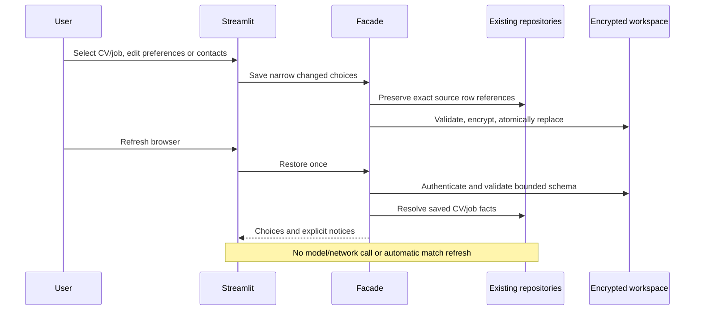

# Engineering review — 2026-10-19

CareerAgent remains a local-first assistant for an individual job seeker: discover
jobs, present truthful candidate facts, track applications and review every
outreach/application action. This pass improves reliability and development
controls within the existing Python/Streamlit architecture. Measurements below
were collected on October 17; the pull request repeats current CI checks.

## Confirmed defects and changes

| Priority | Evidence | Result |
| --- | --- | --- |
| High | Browser refresh discarded deliberate CV/job/contact/preference choices (#48). | Narrow encrypted workspace recovery, atomic private writes, exact source job IDs and visible failure/recovery guidance. |
| High | A fingerprint-only recovery lookup replaced a pasted posting with a similar API posting. | Selection retains exact DB identity; legacy fallback requires all visible source facts to agree. |
| High | Strict PyPI feed scan identified affected Pillow 11.3.0 and pytest 7.4.3. | Patched Pillow 12.3.0/pytest 9.0.3 and compatible asyncio plugin; maintained Python floor and reviewed graphs. |
| Medium | Range-only CI/Docker installs changed underneath reviewed code (#39). | Per-minor hash-verified wheel graphs; CI, Docker and digest consume them; weekly/manual upstream drift remains separate. |
| Medium | A quick preference edit/navigation skipped the page code that copied widget values. | Stable widget keys and callbacks synchronize all four preferences before navigation. Real Chromium and single-event regressions pass. |
| Medium | JSON brace-counting truncated braces inside valid model strings; invalid retry budgets could return no object. | Standard JSON decoder handles strings/escapes; positive retry budgets and object envelopes are enforced. |
| Medium | Contact-query prompt requested an array while the client required objects; malformed provider shapes and incomplete email regenerations escaped validation. | Consistent object prompt, guarded provider envelopes and nonblank regenerated text. |
| Medium | Existing type errors were advisory. | Full-repository mypy is clean and required through the shared local/CI command. No added casts or blanket suppressions. |
| Verification gap | Local inference had not actually parsed a CV (#26). | Checksum-verified Ollama/3B model ran real synthetic text/PDF parsing and restart tests locally. |

No application, email, Telegram or Discord message was submitted. No historical
personal document was inspected or copied. Candidate fixtures and screenshots
are synthetic. Each workstream recorded design/root-cause/security/testing and
rollback review before implementation; independent reviews found the job identity
bug and the real-browser preference test found the navigation race.

## Architecture and product behavior

`core/workspace.py` validates bounded recoverable choices; facade wrappers resolve
CV/job facts from existing repositories. It does not serialize arbitrary session
state. Clients, credentials, unsent drafts and approvals never recover. Missing
records produce notices. Wrong-key/corrupt files block replacement; explicit reset
preserves a private ciphertext backup. The file is readable only through explicit
export. No database migration or runtime package was added for this feature.

Global discovery scores still lack profile provenance, so restored CVs show a
re-score notice. This is one trusted local workspace; multiple tabs use the last
successful save rather than conflict-aware synchronization. Existing direct
legacy calls from `app.py` remain architectural debt (#12); adding a second
framework or broad refactor would not resolve these specific defects.

## Security, dependencies and developer experience

The package scan reported 37 advisory entries, including duplicates, across two
installed packages; this is not 37 distinct confirmed exploitable flaws. Fixed
graphs for CPython 3.11/3.12/3.13 and the isolated audit tool returned zero known
feed findings. [Recorded evidence](validation/dependency-audit-2026-10-17.json)
includes exact package versions and lock hashes. Feed coverage is time-dependent
and does not audit application code, OS packages or the Docker base.

Python 3.9 and 3.10 are retired: their official end-of-life dates precede this
review, and fixed dependencies cannot support the old floor. README explains
upgrading into a new environment while keeping data paths and the existing key.
Seven generated graphs cover runtime/test per maintained minor and the isolated
scanner. They target Linux x86_64, not every architecture/OS. Standard pip consumes
them; uv is only a development resolver. See [refresh/install guidance](../requirements/locks/README.md).

CI requires static checks, supported-runtime tests, actual advisory scans and
functional Docker validation. It preserves audit JSON and fails on feed errors
or findings without ignored advisory IDs. Dependabot monitors source manifests
and Actions; custom lock regeneration still requires review. Repository-admin
secret-scanning settings could not be established from the available metadata;
#24 remains open for that separately. No secret-scanning enablement is claimed.

## Measured validation and performance

The final local shared check passed **816 Python tests, 55 extension tests,
Ruff lint/format and full-repository mypy**. Core coverage is **95.20%**, above
94.83%. Seven SQLModel class-registry warnings arise from tests deliberately
reloading the schema module to verify metadata/index behavior; none was suppressed.
Fresh frozen installs and dependency-consistency checks passed on all three
runtimes. Earlier concurrent matrix runs exposed two in-flight UI handoff failures;
their source-identity correction passed targeted locked tests before the final
full suite. Final PR CI is the authoritative completed supported-runtime matrix.

Docker validated real screens, private generated-key persistence/decryption across
container replacement, nonroot runtime and HTTP health. Actionlint validated the
workflows. A deliberately invalid wheel hash was rejected. Digest dry-run tests
for empty URL and migrated synthetic data ran without opening a network client.
The latest two inspected scheduled digest runs succeeded; historical failure
logs were inaccessible, so no unproven historical root cause is claimed (#25).

Real Chromium 154 exercised model-free CV creation, selected-job/contact entry,
immediate preference edit/navigation, browser reload, CV/preferences restoration,
desktop and mobile rendering. It reported no page errors or mobile document
horizontal overflow. This is representative browser coverage, not a full
accessibility or cross-browser certification.

| Offline workload, 30 warmed samples | Median | p95 |
| --- | ---: | ---: |
| Build synthetic CV | 0.0146 ms | 0.0219 ms |
| Assess CV against one job | 0.8793 ms | 1.2982 ms |
| Render selectable PDF | 85.6146 ms | 152.0078 ms |
| Hash-match 100 jobs | 12.6297 ms | 14.7291 ms |

[Benchmark evidence](validation/benchmark-local-2026-10-17.json) separates latency
from one-operation Python allocation peaks; it does not measure process RSS.
Run `python -m scripts.benchmark_local --output /tmp/benchmark.json`. This is a
shared-machine local baseline, not a speedup, load/stress test or production SLA.

Local model validation used checksum-verified Ollama 0.40.4, llama3.2:3b/Q4_K_M,
two CPU threads and an 8 GiB container cap. Real text parsing took 81.40 s; the
definitive final-code/frozen-graph PDF parse took 75.35 s. Supplied contacts,
URLs, roles, dates, skills, project, education and metric were checked; missing
contact fields remained absent. This does not establish general factual accuracy.
The task-owned runtime was recreated against the patched base image and tested
for model persistence, real JSON generation and idempotent startup.
Explicitly select `llama3.2:3b`; the repository's generic 8B default was not
installed. Longer inputs can exceed the unchanged 120-second client timeout.

## Remaining work and rollback

- Critical: public-history personal data requires owner-led cleanup, #38. No
  destructive history rewrite/force-push is authorized or performed here.
- High before hosting: outbound URL controls must cover address resolution,
  redirects, rebinding and the supported proxy path (#41). Mock-only review
  reconfirmed both fetch paths accept internal destinations; no internal service
  was contacted. Loopback Compose publication remains the supported scope.
- High: identifying database metadata needs a deliberate compatible encryption
  migration, #42; encrypted workspace state does not repair older metadata/backups.
- AI quality: evidence-oriented extraction/cover-letter evaluation and matching
  quality remain #43/#10. One synthetic parse is not a model accuracy benchmark.
- Hosted authentication/isolation, Postgres integration, Gmail OAuth/delivery,
  live extension form submission behavior, OS/container scanning and fresh
  published-environment restoration remain unverified.

Use GitHub issues for follow-up rather than unexplained TODOs. Runtime migration
and lock decisions are in ADR 0012; recovery behavior is ADR 0011. Roll back
coherent source/workflow/lock changes while retaining DB/artifacts/key and any
workspace ciphertext backups. Do not restore vulnerable packages simply to keep
an obsolete interpreter, discard records or generate a replacement key.
