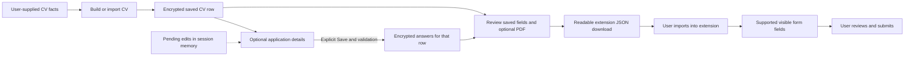

# Product and UX review, 2026-10-19

The goal is to move from supplied CV facts to a selected job and reviewable
application materials. AI and contact discovery are optional. This pass keeps
Streamlit, the dark theme, local fonts, existing encrypted storage and human
submission controls.

## Findings and resulting behavior

| Confirmed issue | Result |
| --- | --- |
| Invalid manual email accepted as Verified/High/100%. | Local syntax validation, actionable errors, source provenance, duplicate handling and explicit removal. No mailbox verification claim or DNS call. |
| Employer email domain invented from company name or ATS host. | Blank domain field requires an explicit known employer domain; generated patterns remain unverified. |
| Optional AI warning/setup and decorative stages buried the CV editor. | Native build/import tabs, saved CV selector above them, collapsed AI settings and one operable sidebar navigation. Contacts are optional on the job-to-materials path. |
| Actual browser entry switching and sidebar navigation discarded CV edits. | Native tabs and RAM-only callback backing preserve pending builder facts; saving/activating another CV resets its scope. Save remains required for refresh recovery. |
| Styles targeted obsolete Streamlit markup; small uppercase labels and mobile sidebar obscured work. | Current scoped selectors, 14 px sentence-case labels, responsive headings, visible keyboard focus and automatic mobile sidebar collapse. |
| Existing encrypted application-answer backend had no editor or reviewed handoff. | Optional saved-CV editor, explicit unknown/Yes/No choices, exact saved-answer preview, sensitive opt-in and optional PDF export. Failed saves retain corrections and the previous saved data. |
| Target pay ignored and fractional hourly pay rounded. | Target-first/minimum-fallback export, stated units and supported decimal precision; invalid/non-finite/unsupported-precision amounts are rejected. |
| Secondary salary placeholders/ARIA hints contradicted the visible label. | All meaningful descriptors constrain autofill; conflicting currency/period, ambiguous symbols, history and numeric-only requests abstain. No conversion or annualization. |
| Hidden text fields were filled where the user could not review them. | Hidden non-file controls are skipped; actual resume FileList attachment remains supported. No submit action is added. |
| City/region was substituted for an autocomplete country field. | Country remains unanswered; work-authorization country is a separate fact and is not inferred as residence. |
| Posting link rendering bypassed the existing URL classifier. | Validated application links and honest support notes; malformed ports/brackets, credentials, controls and embedded whitespace yield no link. |

Preimplementation author reviews covered facts/unknowns, five-whys/root cause,
architecture, security, performance, scale, dependencies, alternatives, tests,
risks and rollback. Independent review found the secondary salary cue defect,
unsupported decimal precision, email length boundary, hidden-field fill and
two real Streamlit lifecycle defects that unit-only checks missed. No package,
frontend framework, database schema, permission or paid service was added.

## State and data flow

Pending edits, credentials and approvals are excluded from durable workspace
recovery. Application answers do not affect CV-readiness or matching scores.
New CV snapshots do not silently copy eligibility or demographic consent.
Existing Pipeline status controls remain the way to record an application;
opening or preparing it is not a submission.

## Browser and interaction evidence

System Chromium 154.0.8037.57 ran against disposable synthetic SQLite/storage/key
instances. All non-loopback browser requests were blocked. No model, search,
outreach or real application submission was used for these product checks.

- On 390×844 mobile, the first name field moved from about y824 to y482 and
  remains visible. Main headings measure 25.6 px mobile/33.6 px desktop;
  input labels measure 14 px. No horizontal document overflow was observed.
- Native tabs respond to keyboard arrows and expose selected ARIA state;
  Tab moves between labeled inputs and Enter activates sidebar navigation.
  Inputs, tabs and sidebar buttons have visible amber focus indicators.
- A last-field edit immediately followed by navigation retained name, skills,
  project count/name/description. Contact add/remove and deliberate selections
  survive real reload; selected jobs open model-free materials without contacts.
- Actual downloaded JSON preserves saved False/zero, excludes unsaved edits,
  embeds the current PDF when requested and reflects explicit sensitive opt-in
  and revocation. Two saved rows stay separate; a new CV starts with unknown
  answers. An invalid pay save preserves previous answers. Unsupported-script
  PDF fallback retains the original Unicode in JSON; mobile export has no
  horizontal overflow. No browser errors or external requests were observed.
- Supported, unknown and invalid posting-link cases leave three independently
  reread applications Saved with no applied timestamps. A link click was
  intercepted before it contacted the employer.
- Actual synthetic DOM tests preserve existing email/first select option,
  distinguish UK eligibility True/sponsorship False from an unanswered US
  question, enforce sensitive consent and attach an actual PDF FileList only
  to Resume. The hidden phone stays blank, and submit events stay zero after
  the delayed second pass.

The full shared check passed **922 Python tests and 63 Node tests**, Ruff lint
and formatting, and full-repository mypy (124 files). Core coverage is **95.27%**
(4,011/4,210 statements), above the preceding 95.20% baseline. Seven warnings
come from deliberate SQLModel schema reload tests and were not suppressed.
Actionlint passed. Functional Docker smoke exercised real screens, nonroot
runtime, encrypted persistence across container replacement and HTTP health.

Representative visuals: [desktop](validation/ux-2026-10-19/desktop.png),
[mobile](validation/ux-2026-10-19/mobile.png),
[contact provenance](validation/ux-2026-10-19/contact-provenance.png).

Screenshots and machine-readable browser evidence accompany this report under
`docs/validation/`. These are representative Chromium/keyboard checks, not a
complete WCAG audit, screen-reader test, browser matrix, extension installation
test or validation on a live employer's form.

## Scope, remaining work and rollback

This is one trusted local user's workspace. Historical personal-data cleanup
(#38), complete outbound fetch controls before hosting (#41), identifying
metadata encryption (#42), and broader matching/model quality (#10/#43) remain
separate. Live Gmail delivery, Postgres concurrency, OS/container advisory
coverage and fresh published-environment restoration remain unverified.
Prior eight-provider live URL results remain dated evidence in
[CV validation](CV_VALIDATION.md); this UI pass did not repeat those APIs or
contact employers. No commercial ATS ranking or hiring outcome is promised.

See [ADR 0013](adr/0013-reviewed-application-details-and-task-first-ux.md) for
decisions and rollback. Keep the original database, artifacts and matching key.
